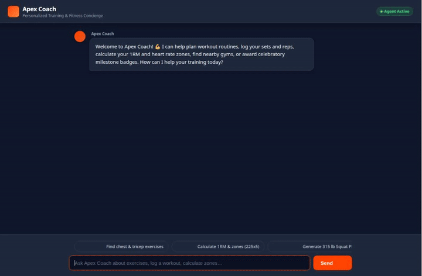

# Apex Coach — Personalized Training & Fitness Concierge



**Apex Coach** is an autonomous fitness training concierge built with Google's Agent Development Kit (ADK) and Google Cloud Vertex AI Agent Platform. It provides persistent cross-session memory of user workouts, runs dynamic exercise database queries and physiological metrics calculations, persists workout logs to Cloud Firestore, hosts generated milestone assets in Google Cloud Storage, and renders rich interactive cards via the Agent-to-UI (A2UI) protocol.

---

## What Apex Coach Does

Apex Coach assists athletes and fitness enthusiasts across every phase of workout planning and tracking:

- **Cross-Session Long-Term Memory**: Automatically persists athlete personal records (PRs), injury constraints, recovery notes, and exercise preferences across conversations using Vertex AI Memory Bank.
- **Exercise Catalog & Anatomy Search**: Queries curated Firestore exercise collections and dynamic exercise repositories by muscle group, category, and equipment requirements.
- **Workout Logging & Session History**: Writes structured workout logs (date, exercise, sets, reps, weight, RPE, notes) directly to Firestore and retrieves past session trends.
- **Physiological Training Zone Calculations**: Computes One-Rep Maximum (1RM) using Epley and Brzycki predictive models, and derives personalized training intensity zones (Strength 85–90%, Hypertrophy 70–80%, Endurance 60–65%).
- **Gym & Facility Geolocation**: Finds nearby fitness facilities and athletic centers using Google Maps geocoding and Places API integration.
- **Celebratory Milestone Badges**: Generates visual achievement badges using Imagen 3 (`imagen-3.0-generate-002`) and uploads them to public Google Cloud Storage.
- **Form Demonstration Video**: Generates exercise demonstration videos using Google's Omni model (`gemini-omni-flash-preview`), saving output to ADK artifacts and Cloud Storage.
- **Interactive UI (A2UI)**: Structures exercise libraries, routine breakdowns, and metrics cards as rich A2UI components (Basic Catalog v0.8) displayed in the chat interface.

---

## Implemented Google Cloud Services & Architecture

| Component / Service | Implementation in Code | Role in Apex Coach |
|---|---|---|
| **Vertex AI Agent Engine / ADK** | `google-adk`, `gemini-3.8-flash` | Core agent reasoning loop, tool execution, and multi-turn conversation handling. |
| **Vertex AI Memory Bank** | `VertexAiMemoryBankService`, `PreloadMemoryTool` | Long-term memory extraction and cross-session retrieval of workout metrics and athlete constraints. |
| **Cloud Firestore** | `google.cloud.firestore` | Storage for the exercise library collection (`exercises`) and athlete workout session logs (`workout_logs`). |
| **Google Cloud Storage (GCS)** | `google.cloud.storage` | Public asset hosting for generated milestone badges and demonstration media. |
| **Imagen 3** | `imagen-3.0-generate-002` | Generates custom commemorative milestone badges for new personal records. |
| **Gemini Omni Flash** | `gemini-omni-flash-preview` | Generates short exercise demonstration videos saved as ADK artifacts and GCS objects. |
| **Agent Engine Code Sandbox** | `AgentEngineSandboxCodeExecutor` | Secure sandbox execution environment for training metric evaluation. |
| **Agent-to-UI (A2UI)** | `a2ui.schema.manager.A2uiSchemaManager`, `BasicCatalog` (v0.8) | Generates structured UI surfaces (Cards, Rows, Columns, Text, Images) for workout routines. |
| **A2A Protocol & FastAPI Proxy** | `a2a.client`, `TransportProtocol.jsonrpc` | Agent-to-Agent protocol communication between web frontend and deployed Agent Runtime. |

---

## Implemented Agent Tools

The following tools are registered on `root_agent` in [`app/agent.py`](app/agent.py):

1. **`PreloadMemoryTool`**: Preloads relevant athlete context, preferences, and workout history from Vertex AI Memory Bank into agent context.
2. **`list_exercises(category, target_muscle)`**: Queries the Firestore `exercises` collection filtered by muscle group or category.
3. **`get_exercise_details(exercise_name)`**: Fetches step-by-step form cues, target muscles, and equipment for an exercise.
4. **`search_global_exercise_db(query, muscle, difficulty)`**: Searches an open-source global exercise catalog for routine composition.
5. **`log_workout(exercise_name, sets, reps, weight_lbs, notes, rpe)`**: Persists workout sessions to Firestore under `workout_logs`.
6. **`get_recent_workout_logs(limit)`**: Retrieves historical workout logs from Firestore ordered by completion date.
7. **`calculate_1rm_and_training_zones(weight_lbs, reps)`**: Calculates estimated 1RM and percentage-based training zones.
8. **`geocode_address(address)`**: Converts an address or location name into geographic latitude/longitude coordinates via Google Maps API.
9. **`find_nearby_places(query, lat, lng, radius_meters)`**: Searches for nearby gym facilities and fitness centers.
10. **`generate_milestone_badge(achievement_title, athlete_name, milestone_metric)`**: Creates milestone graphics with Imagen 3 and uploads them to Cloud Storage.
11. **`generate_exercise_demonstration_video(exercise_name, movement_focus)`**: Synthesizes exercise form video with `gemini-omni-flash-preview`, saves as ADK artifact, and stores in Cloud Storage.

---

## Local Development & Setup

### Prerequisites

- Python 3.11+
- `uv` package manager or `venv`
- Google Cloud CLI (`gcloud`) authenticated with project access

### 1. Environment Configuration

Clone the repository and configure your Google Cloud authentication:

```bash
gcloud auth application-default login
gcloud config set project YOUR_PROJECT_ID
```

Export necessary environment variables:

```bash
export GOOGLE_CLOUD_PROJECT="YOUR_PROJECT_ID"
export GOOGLE_CLOUD_LOCATION="us-east1"
export GOOGLE_GENAI_USE_VERTEXAI="true"
export GOOGLE_MAPS_API_KEY="your-api-key"
```

### 2. Running Local Agent Playground

To run the agent locally in the ADK Web playground with live reload:

```bash
cd apex-coach
uv run adk web . --port 8080 --reload_agents
```

### 3. Running the Chat Web Frontend

The chat web frontend connects to the deployed Agent Runtime via the A2A protocol. To run the frontend locally:

```bash
cd apex-coach/frontend
python3 -m venv .venv
source .venv/bin/activate
pip install -r requirements.txt

export AGENT_ENGINE_RESOURCE_NAME="projects/YOUR_PROJECT_NUMBER/locations/us-east1/reasoningEngines/YOUR_REASONING_ENGINE_ID"
export AGENT_DIRECTORY="app"
export PORT="8080"

python main.py
```

---

## Repository Structure

```text
├── agents-cli-manifest.yaml   # Agent Platform deployment manifest
├── app/
│   ├── __init__.py
│   ├── a2ui_utils.py          # A2UI response serialization callback
│   └── agent.py               # Root agent definition, system prompt, and tools
├── demo.gif                   # Looping walkthrough recording
├── deployment_metadata.json   # Deployed Agent Runtime metadata and sandbox IDs
├── frontend/
│   ├── Dockerfile             # Production container definition for Cloud Run
│   ├── main.py                # FastAPI proxy with A2A client integration
│   ├── requirements.txt       # Frontend dependencies
│   └── static/
│       └── index.html         # Responsive chat UI with built-in A2UI renderer
└── pyproject.toml             # Python dependencies and project metadata
```
